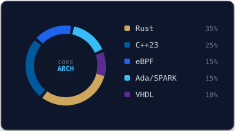

<!-- Dynamic Header Gradient -->

<!-- Technical Sub-header -->
<code><b>SYSTEMS ENGINEERING</b> • <b>OFFENSIVE SECURITY</b> • <b>HARDWARE / FPGA</b> • <b>FORMAL VERIFICATION</b></code>

  

<!-- Dynamic Typing SVG -->

 

<!-- Modern Animated Line Divider -->

 

### 🌌 Executive Summary

<table width="100%">
  <tr>
    <td width="52%" style="vertical-align: top; padding-right: 8px;">
      <!-- Główna karta z opisem i elementami UI -->
      
        
        <!-- Górna belka statusowa (Claude Code Header) -->
        

          
            ● ARCHITECT_PROFILE // OVERVIEW
          
          v2026.4
        

        <!-- Główny opis -->
        

          Software Engineer &amp; Security Analyst focused on <b>low-level systems engineering</b>, <b>hardware description</b>, <b>offensive security</b>, <b>CTI telemetry</b>, and <b>defensive AI architectures</b>.
        

        <!-- Kafelki kompetencji (Struktura zamiast postrzępionych punktów) -->
        
          
          

            CORE DOMAINS 
            Purple Team Ops • Threat Intel • eBPF Telemetry
          

          

            PHILOSOPHY 
            High Assurance • Zero-Trust • Formal Verification
          

          

            ACADEMIC TRACK 
            Double Degree: Software Engineering &amp; Internal Security
          

          

            DISTINCTIONS 
            Laureate &amp; Finalist: NASA Space Apps, NASK, CISPA
          

        

      

    </td>    
    <td width="48%" align="center" style="vertical-align: middle;">
      <!-- Wykres telemetryczny SVG (stack-chart.svg) -->
      
    </td>
  </tr>
</table>

 

### 🛡️ Featured System: SANCTUM SUITE `[Closed-Source]`

> **Field Notes from the Architect:**  
> *"SANCTUM SUITE is my custom-built, high-assurance CTI workspace. I built it to solve a specific problem: ingesting raw threat data from disparate SIEMs and network sensors, verifying its cryptographic provenance on the fly, and running real-time graph telemetry without trusting third-party cloud infrastructure."*

 

<!-- Dynamic Terminal Boot Sequence SVG -->

  

 

### 🛠️ Core Technical Stack & Ecosystem

#### 🚀 **Low-Level & High-Assurance Languages**

  
  
  
  
  
  
  

#### 🛡️ **Kernel Telemetry, Cryptography & Security Systems**

  
  
  
  
  
  

#### 🗄️ **High-Performance Engines & Infrastructure**

  
  
  
  
  

 

### 🏆 Honors, Awards & Hackathons

| Event / Institution | Role & Distinction | Domain Focus |
| :--- | :--- | :--- |
| **NASA Space Apps Challenge** | Laureate / AeroSec Dev | SAR Satellite Telemetry & Spatial Intelligence Platform |
| **CISPA European Champs** | Champs Finalist / AI Dev | Adversarial Machine Learning & Cyber Defense |
| **NASK DISINFOHACK** | Finalist / Tech Dev | Information Operations & Disinformation Mapping |
| **Consult IT Competition** | Laureate / ML Developer | Sales Forecasting & ML Inventory Optimization |
| **INNOWO Circular Shift** | Finalist | Sustainable Business Model Transformation |

 

### 📝 Key Publications & Research

- 📡 **„Wojna algorytmów 2026: Jak wygląda automatyzacja ofensywnych kampanii InfoOps w polskiej cyberprzestrzeni?”**  
  *Research article analyzing algorithmic InfoOps automation, automated botnet campaigns, and defense strategies in the domestic digital sphere.*
- 🛰️ **„Kiedy algorytm przejmuje stery: Dlaczego bezpieczeństwo systemów AI i dronów w erze InfoOps wymaga zmiany paradygmatu?”**  
  *In-depth analytical publication covering AI flight control integrity, autonomous drone swarm security, and paradigm shifts in InfoOps defense.*

 

<!-- Modern Animated Line Divider -->

 

### 📊 Telemetry & Activity

  
  

 

<!-- Modern Dynamic Status Footer Badge -->

  
  

